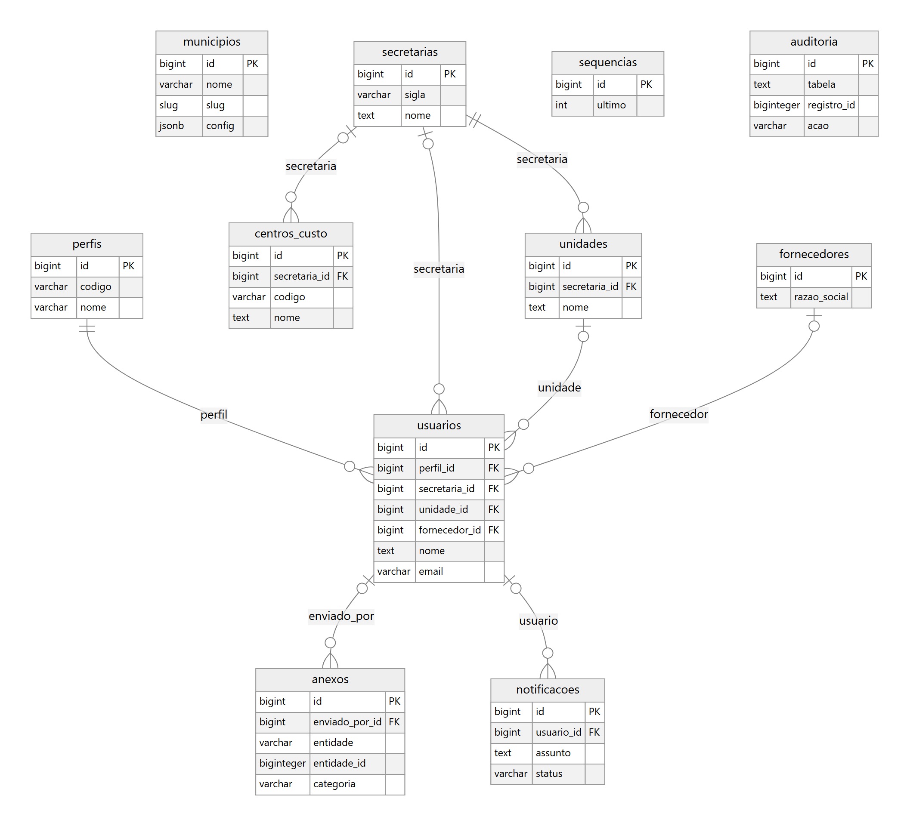
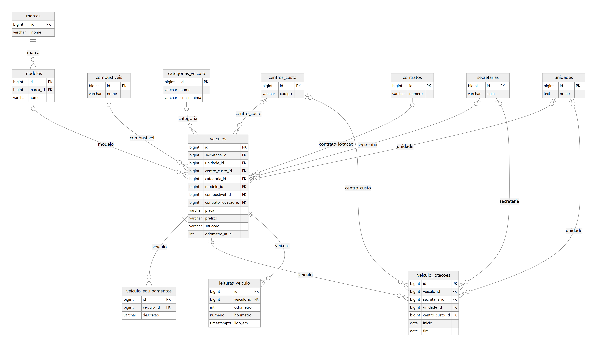
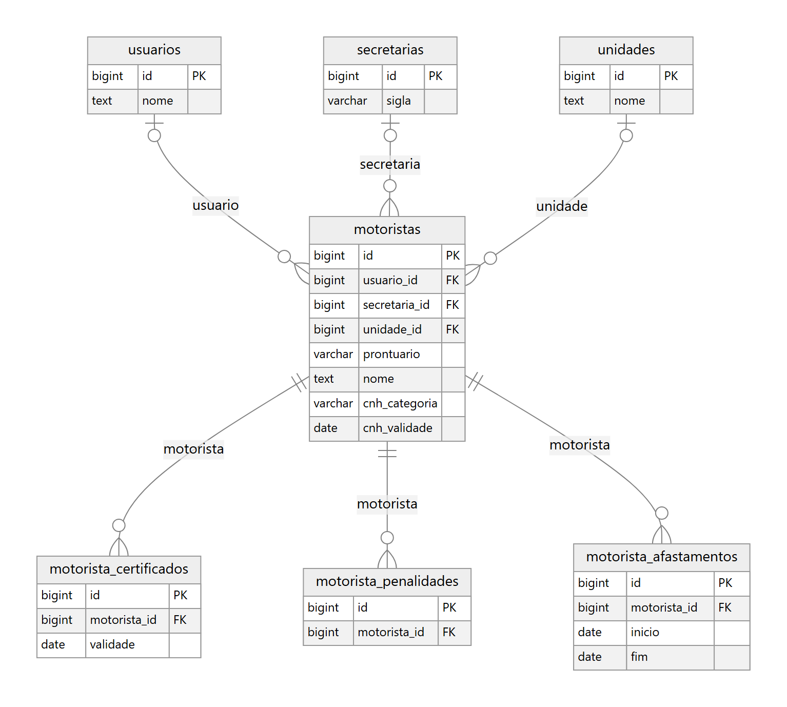
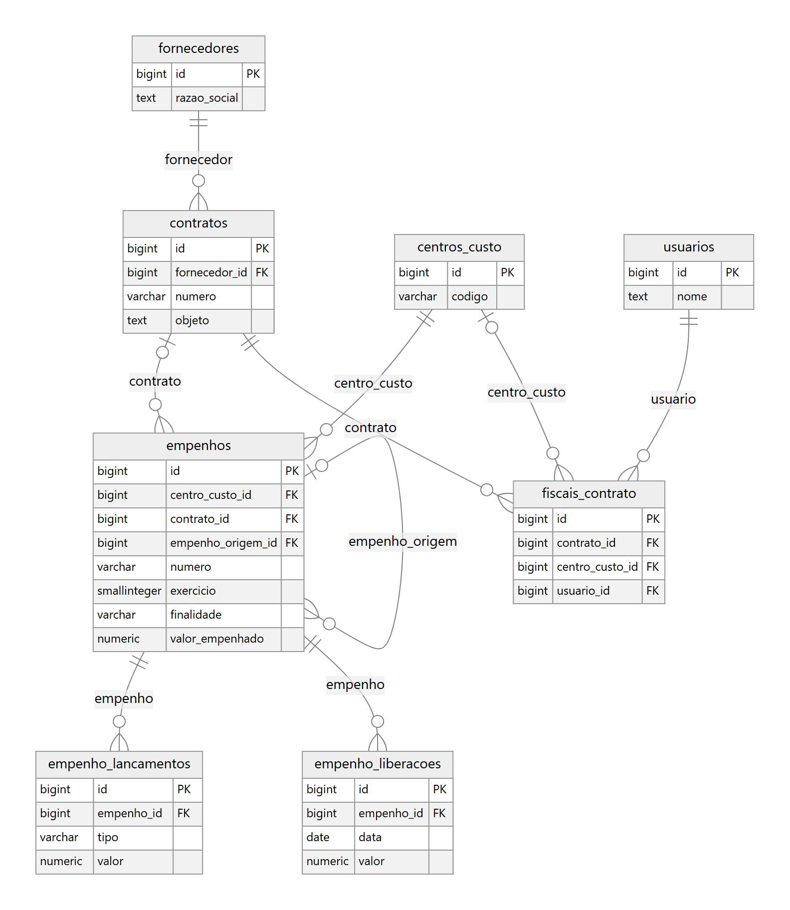
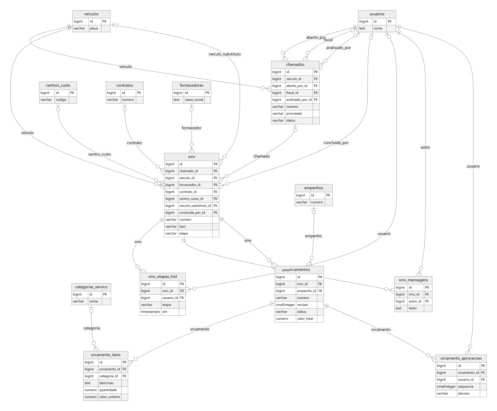

# Diagrama ER

Gerado dos models do Django (fases 0 a 2): 36 tabelas, uma figura por módulo. As tabelas de outros módulos aparecem resumidas, só para mostrar as ligações.

Toda tabela de negócio também tem `municipio_id` (isolamento entre prefeituras); ele e os campos de auditoria (`criado_por`, `atualizado_por`) foram omitidos do desenho.

## Estrutura e acesso (core)

## Frota

## Motoristas (pessoas)

## Contratos e empenhos (financeiro)

## Manutenção

As versões em `.svg` ficam na mesma pasta (`docs/diagrama_er/`), para ampliar sem perder qualidade.
